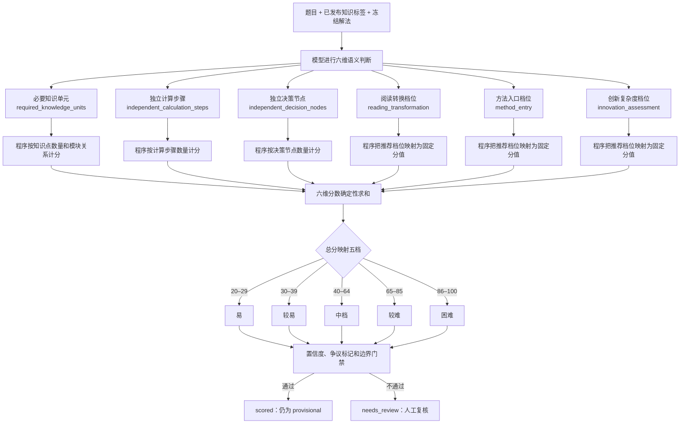

# 数学难度计算链路参考包 v1

> 历史快照：本文件记录的是“一次模型调用同时输出六维”的 v1 结构。当前默认数学路由已由 v2 的六维独立并行节点取代，请以 `math-difficulty-parallel-six-node-v2.md` 为准。

## 1. 使用范围

本分支用于把当前数学难度计算链路交给英语难度链维护者参考。

- 来源链路：`difficulty_tagging_registered_v01`
- 数学路由：`math.senior.default.v1`
- 注册表版本：`difficulty-registry-2026-09-15-v06`
- 数学量表版本：`six_dimension_100_point_v0.1`
- 数学 prompt：`math_senior_six_dimension_v01`
- prompt 版本：`2026-09-18.13-contract-clarified`
- 五档方案：`five_band.v1`
- 当前状态：`trial`

这是一份可审阅的代码参考快照，不表示数学链已经通过生产门禁，也不表示英语路由已经启用。数学历史 25 题校准精确档位命中为 14/24，当前版本未完成冻结验证和全量验收。

## 2. 难度计算链路



核心分工：模型负责教学语义判断；代码负责来源、引用和结构校验，以及离散分值、总分和五档的确定性计算。不得使用关键词或正则表达式代替教学判断。

## 3. 数学六维计分

| 维度 | 计算方式 |
|---|---|
| 知识点复杂度 | 1 个知识单元 2 分；同模块 2 个 4 分；跨模块 2 个 6 分；同模块不少于 3 个 8 分；跨模块不少于 3 个 10 分 |
| 计算复杂度 | 1–4 步 3 分；5–8 步 6 分；9–13 步 9 分；14–17 步 12 分；18 步及以上 15 分 |
| 思维复杂度 | 0–1 个节点 5 分；2 个 10 分；3 个 15 分；4–5 个 20 分；6 个及以上 25 分 |
| 阅读转换复杂度 | 模型判断 1–5 档，映射为 3、6、9、12、15 分 |
| 方法复杂度 | 模型判断 1–5 档，映射为 4、8、12、16、20 分 |
| 创新复杂度 | 模型判断 1–5 档，映射为 3、6、9、12、15 分 |

业务补充口径：必要知识单元按知识树三级标题计数；当前代码按一级标题判断同模块/跨模块。一个可复用中间结论计为一个计算步骤；立体几何中标点坐标整体算一步、写出向量整体算一步。

## 4. 文件索引

| 文件 | 作用 | 英语侧参考方式 |
|---|---|---|
| `config/difficulty_tagging/registry_v01.yaml` | provider、五档标签、数学 route 和禁用的英语 draft routes | 复用注册路由骨架，不直接启用 draft route |
| `config/difficulty_tagging/prompts/math_senior_six_dimension_v01.yaml` | 当前数学六维 prompt 与 reviewed few-shot | 只参考 prompt 包结构、证据引用和输出约束；不复制数学维度语义 |
| `config/difficulty_tagging/prompts/english_senior_three_to_five_draft_v01.yaml` | 已登记但未启用的英语研究草稿 | 作为历史起点，不作为已验收标准 |
| `tools/difficulty_tagging/contracts.py` | 六维 schema、固定计分和五档映射 | 复用“语义判断与程序投影分离”的模式；英语需独立 schema/投影 |
| `tools/difficulty_tagging/registry.py` | route 匹配与配置校验 | 可复用 |
| `tools/difficulty_tagging/prompt_bundle.py` | YAML prompt/few-shot 加载与哈希 | 可复用 |
| `tools/difficulty_tagging/result_adapters.py` | 学科结果适配器与公共五档投影 | 扩展英语 adapter，不修改数学 adapter 含义 |
| `tools/difficulty_tagging/run_registered_batch_v01.py` | 上游门禁、payload、模型调用、结果门禁和 trace | 可复用编排骨架；英语 payload 粒度需按题型定义 |
| `tools/difficulty_tagging/tag_difficulty_v01.py` | 已发布知识标签的紧凑投影等兼容函数 | 只复用结构桥接，不套用数学知识树口径 |
| `tools/knowledge_tagging/model_api.py` | 模型调用、限流、重试和熔断 | 可复用传输层 |
| `tests/test_difficulty_registry_runtime.py` | 路由、合同、引用、边界、resume 和重复性测试 | 复制测试模式并新增英语题型样例 |

## 5. 英语侧可以复用的部分

1. `subject / stage / question_type` 注册表路由。
2. YAML prompt、few-shot 和 SHA256 版本固定。
3. 上游结果发布门禁。
4. 模型语义输出与代码确定性投影分层。
5. Pydantic schema、来源引用与 token/ID 保真校验。
6. `scored / needs_review / failed / skipped` 状态与审计 trace。
7. 置信度、争议标记、边界复核、冻结验证和重复性门禁。

## 6. 英语侧不能直接照搬的部分

1. 不能把数学六维名称、分值或总分区间自动视为英语业务标准。
2. 不能使用数学知识树“三级标题计数、一级标题判断同跨模块”的口径。
3. 不能把数学“计算步骤、决策节点、冻结解法图”原样套在阅读、完形、写作等题型上。
4. 英语父题、子题、空位和写作任务的判断粒度必须由英语合同明确；父题档位不能简单平均。
5. 当前 `english_senior_three_to_five_draft_v01` 和 7 条英语 route 均为 `draft/disabled`，未形成已验收的五档金标和发布门槛。

## 7. 本地验证

在仓库已有 Python 环境具备 `pytest`、`pydantic`、`PyYAML`、`httpx` 时运行：

```powershell
python -m pytest tests/test_difficulty_registry_runtime.py -q
```

该测试不需要真实模型密钥；在线模型运行才需要环境变量 `ARK_API_KEY`。

## 8. 未包含内容

- 未包含用户或生产密钥。
- 未包含历史失败 prompt、全量输出和私有金标题目。
- 未包含队列、worker 和数据库迁移，因为本包只展示难度计算链路。
- 未包含三节点“六维 + 整体档位 + 裁决”试验链，因为它尚未进入注册主链。
- 未包含旧 active manifest：其数学 prompt 哈希与本快照不一致，避免让同事误以为该 manifest 已锁定当前 prompt。

