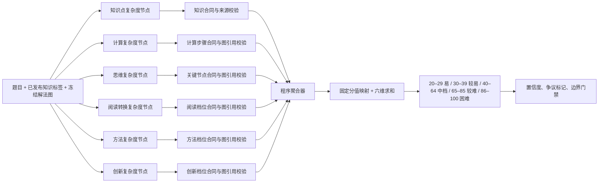

# 数学难度六节点并行链路参考包 v2

## 1. 当前结论

当前数学 route 已从“一个模型节点同时完成六维判断”切为“同一道题横向启动六个独立维度节点”。六个节点互不读取彼此输出；全部通过独立合同后，由程序确定性计分、求和并映射五档，不再增加综合评分模型。

- 链路：`difficulty_tagging_registered_v01`
- route：`math.senior.default.v1`
- 注册表：`difficulty-registry-2026-10-15-v07`
- 执行模式：`parallel_dimension_nodes_v1`
- 结果适配器：`math_parallel_dimension_projection_v1`
- 六维节点 schema：`math_difficulty_dimension_judgment_v1`
- 聚合结果 schema：`question_difficulty_result_v0.4`
- 量表：`six_dimension_100_point_v0.1`
- 标签：`five_band.v1`
- 状态：`trial`，不是生产发布

## 2. 实际代码链路

## 3. 六个独立节点

| 节点 ID | 唯一职责 | 输出字段 | prompt |
|---|---|---|---|
| `math.knowledge_complexity.v1` | 必要三级知识单元及同/跨模块关系的证据 | `required_knowledge_units` | `math_senior_knowledge_complexity_v01` |
| `math.calculation_complexity.v1` | 按独立中间结论拆计算步骤 | `independent_calculation_steps` | `math_senior_calculation_complexity_v01` |
| `math.thinking_complexity.v1` | 判断不可缺少的关键决策/前置节点 | `independent_decision_nodes` | `math_senior_thinking_complexity_v01` |
| `math.reading_conversion_complexity.v1` | 判断题面到冻结解法关系的转换难度 | `reading_transformation` | `math_senior_reading_conversion_v01` |
| `math.method_complexity.v1` | 判断学生发现方法入口的难度 | `method_entry` | `math_senior_method_complexity_v01` |
| `math.innovation_complexity.v1` | 判断相对常见教学原型的非模板程度 | `innovation_assessment` | `math_senior_innovation_complexity_v01` |

每个 prompt 明确禁止输出其他维度、总分和最终标签。每个节点都有自己的 YAML、版本、SHA256、few-shot、调用 trace 和失败状态。

## 4. 聚合和重试

1. 同一题的六个维度使用 `ThreadPoolExecutor(max_workers=6)` 横向提交；provider 连接上限和突发令牌均配置为 6。
2. 每个结果先独立校验身份字段、schema、ID 唯一性、冻结图引用；知识维还校验上游 pk、一级模块和三级标题原样引用。
3. 少任一维度时不计算总分，状态为 `failed/dimension_nodes_incomplete`，并记录 `failed_dimension_nodes`。
4. 重跑时，只要输入、注册表和对应 prompt 哈希未变化，已成功维度从原 trace 复用，只调用失败维度。
5. 六维完整后，程序按量表固定规则生成分数和五档；没有第七个模型重新解释题目。

## 5. 文件索引

| 文件 | 作用 |
|---|---|
| `config/difficulty_tagging/registry_v01.yaml` | 六节点注册、执行模式、并发和 provider 设置 |
| `config/difficulty_tagging/prompts/math_senior_*_complexity_v01.yaml` | 六份独立维度 prompt；阅读文件名为 `reading_conversion` |
| `tools/difficulty_tagging/parallel_dimensions.py` | 六个独立 Pydantic 合同、身份/来源/图引用校验、确定性聚合 |
| `tools/difficulty_tagging/run_registered_batch_v01.py` | 同题六维并发、逐节点 trace、部分失败续跑、结果门禁 |
| `tools/difficulty_tagging/contracts.py` | 固定分值、总分、五档映射和最终合同 |
| `tests/test_math_parallel_dimension_runtime.py` | 六节点调用、聚合、缺维失败、未知图引用和单维重试测试 |
| `tests/test_difficulty_registry_runtime.py` | route、prompt、门禁、dry-run 和传输层回归测试 |

旧的 `math_senior_six_dimension_v01.yaml` 仍保留为回退基线，但 `parallel_dimension_nodes_v1` 默认路径不会调用它。

## 6. 已验证范围

- `python -m pytest -q`：23 passed。
- `python -m compileall -q tools/difficulty_tagging tests`：通过。
- 模拟模型调用确认同一道题恰好调用六个维度节点，聚合器不调用模型。
- 模拟一次失败后续跑确认五个成功节点复用，仅调用失败节点。

上述是代码结构和确定性合同验证；本次未付费运行真实模型，也未形成六节点版本的金标准确率结论。投入全量前仍需使用固定测试集做语义准确率、重复性和成本/延迟评测。

## 7. 英语侧参考边界

英语可复用注册表、独立节点、合同、trace、部分重跑和确定性聚合骨架；不能复制数学六维语义、计分权重或冻结解法图定义。英语应按题型注册自己的节点集合和 schema。
